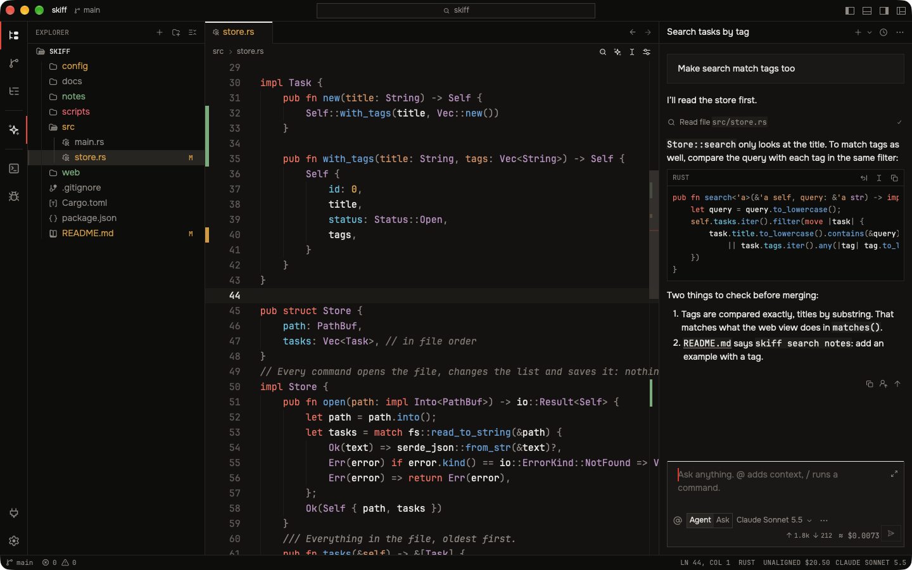
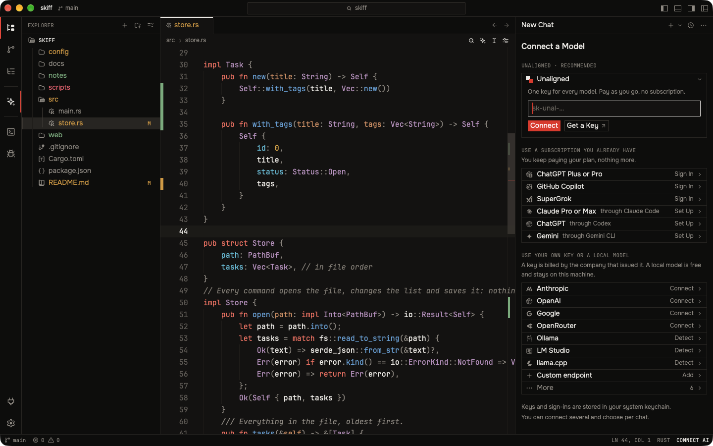
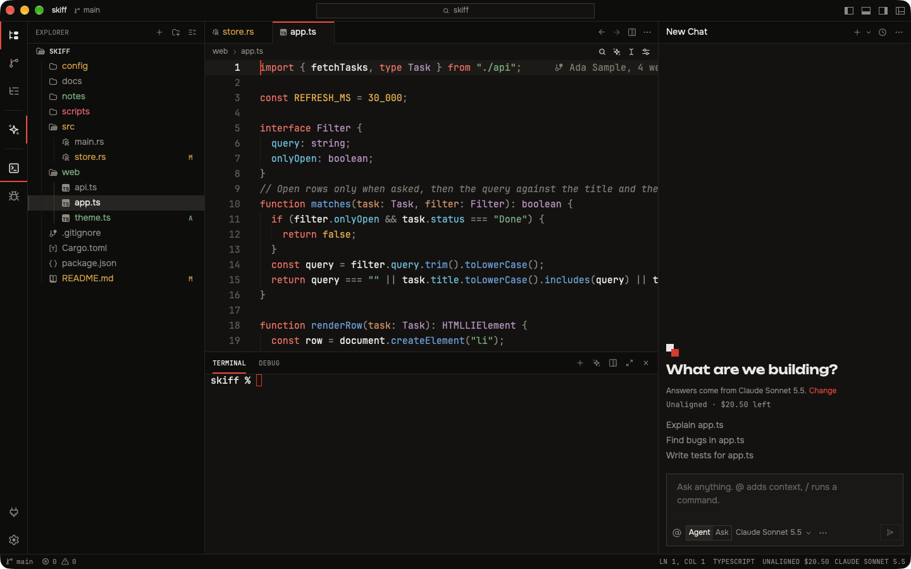
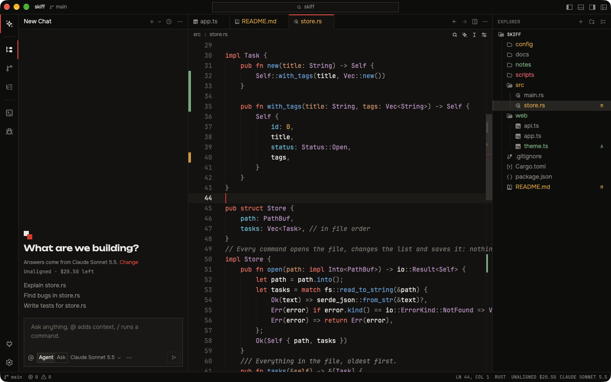
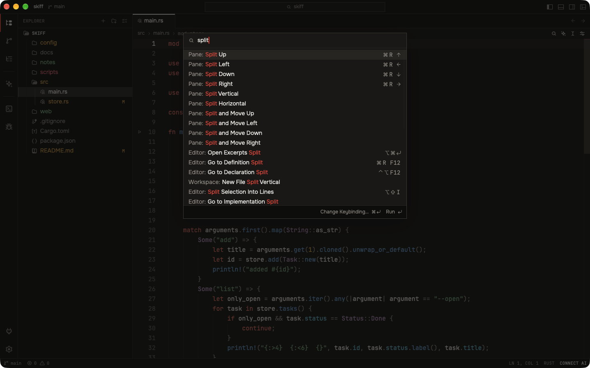
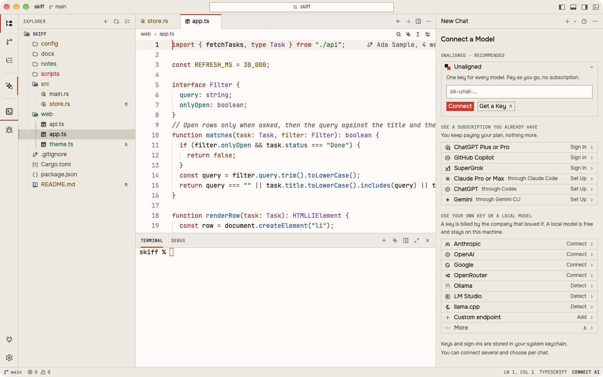
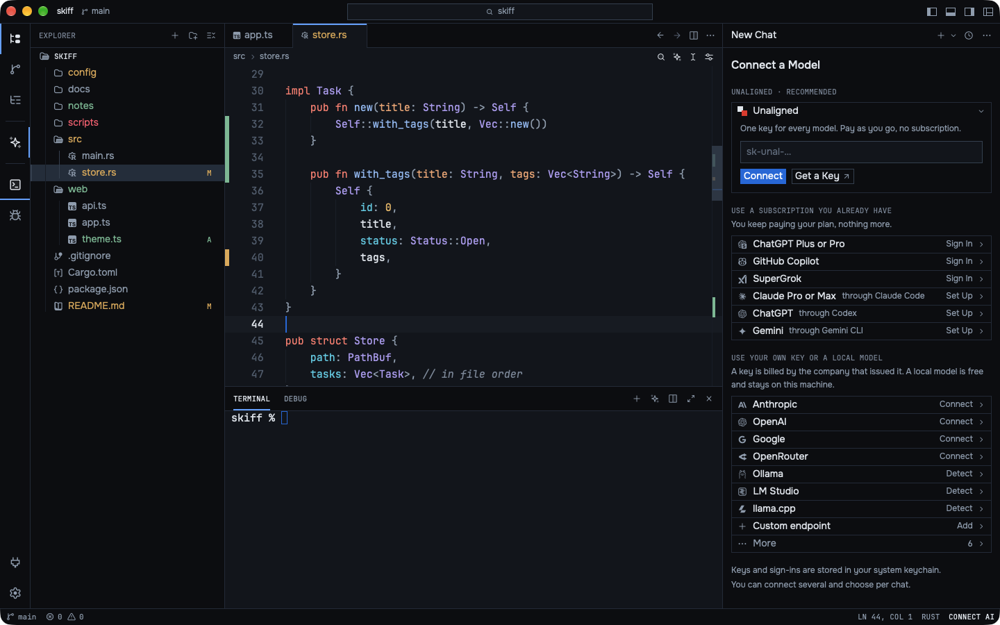

<div align="center">


# Unaligned IDE

**The open-source code editor made for coding with AI.**<br>
Fast, private, and connected to the model you choose.

[](https://github.com/UnalignedSA/unaligned-ide/releases)
[](LICENSE-GPL)
[](#download)
[](#build-from-source)

[](https://github.com/UnalignedSA/unaligned-ide/releases/latest/download/unaligned-ide-windows-x86_64-setup.exe)
[](#download)
[](https://github.com/UnalignedSA/unaligned-ide/releases/latest/download/unaligned-ide-linux-x86_64.AppImage)

[Features](#features) · [Download](#download) · [Connect a model](#connect-a-model) · [Status](#status) · [Build from source](#build-from-source) · [Privacy](#privacy)

<br>



</div>

<br>

Unaligned IDE is a free code editor built around one idea: coding with AI should be simple. One chat panel, one screen to connect a model, and an editor laid out the way you already work. It is written in Rust and drawn on the GPU, so it starts and scrolls fast.

It is a fork of the [Zed](https://github.com/zed-industries/zed) editor. [Unaligned](https://unaligned.pw), a privacy-first, pay-as-you-go AI API, is the featured provider and never the only one.

> [!NOTE]
> **Pre-release (0.1.0).** The editor is developed and run on macOS. The Windows and Linux packages are new and have not been tried on many machines yet: see [Status](#status). "Unaligned IDE" is a working name.

## Features

### Any model, your way



One screen connects everything. You can connect several and choose per chat.

| | |
| --- | --- |
| **Unaligned** | Paste a key, pick a model from the live list with its prices. The balance sits in the status bar and follows your spending. |
| **Subscriptions you already pay for** | ChatGPT, GitHub Copilot, SuperGrok, and the vendors' own agents (Claude Code, Codex, Gemini CLI) inside the same chat. |
| **Your own keys** | OpenAI, Anthropic, Google, Mistral, DeepSeek, xAI, OpenRouter, Amazon Bedrock, or any OpenAI-compatible address. |
| **Local models** | Ollama, LM Studio and llama.cpp, detected on your machine. Free, and nothing leaves it. |

### AI that is simple to use

- **One chat, two modes.** *Agent* reads and edits your files and runs commands. *Ask* only answers.
- **Three shortcuts.** `Ctrl+L` opens the chat with your selection, `Ctrl+K` edits the code under the cursor, `Ctrl+I` starts a new chat (`Cmd` on macOS).
- **You stay in control.** Every edit the agent makes is shown for review: keep or undo, per file or all at once. "Allow All" stops the questions before each tool when you trust the task.
- **Plain words when something is wrong.** Not connected, key refused, balance too low, rate limited, server down: the chat says which, and what to do.
- **You see what it costs.** With Unaligned, each chat shows its cost and the status bar shows what is left.

### An editor you already know



- **VS Code keys and layout by default:** activity bar, explorer, tabs, terminal at the bottom, command palette.
- **Every panel moves.** Drag the explorer, the terminal or the chat to the left, the right or the bottom. Three presets: Classic, AI-First, Zen.
- **Everything a real editor needs,** from Zed's editor underneath: language servers, git, terminal, debugger, project search, extensions.

<table>
  <tr>
    <td width="50%"></td>
    <td width="50%"></td>
  </tr>
  <tr>
    <td align="center"><sub>The AI-First layout: chat on the left</sub></td>
    <td align="center"><sub>The command palette</sub></td>
  </tr>
</table>

### Themes

Five built-in themes (Unaligned, Light, Dusk, Midnight, Contrast), plus One, Ayu and Gruvbox. Corners and accent colour are settings.

<table>
  <tr>
    <td width="50%"></td>
    <td width="50%"></td>
  </tr>
  <tr>
    <td align="center"><sub>Unaligned Light</sub></td>
    <td align="center"><sub>Unaligned Midnight</sub></td>
  </tr>
</table>

### Private by default

No account, no telemetry, no crash reports. Nothing is uploaded but what you send to the model you connected. See [Privacy](#privacy) for the list of what the application contacts.

## Download

Get the latest version from the **[Releases page](https://github.com/UnalignedSA/unaligned-ide/releases/latest)**, or directly:

| Platform | File | First start |
| --- | --- | --- |
| **Windows** 10 and 11, x64 | [`unaligned-ide-windows-x86_64-setup.exe`](https://github.com/UnalignedSA/unaligned-ide/releases/latest/download/unaligned-ide-windows-x86_64-setup.exe) | Run the installer. SmartScreen asks once: "More info", then "Run anyway". No administrator rights needed. |
| **macOS**, Apple Silicon | [`unaligned-ide-macos-aarch64.dmg`](https://github.com/UnalignedSA/unaligned-ide/releases/latest/download/unaligned-ide-macos-aarch64.dmg) | Open the image and drag the application to Applications, then run the command below once. |
| **macOS**, Intel | [`unaligned-ide-macos-x86_64.dmg`](https://github.com/UnalignedSA/unaligned-ide/releases/latest/download/unaligned-ide-macos-x86_64.dmg) | Same as Apple Silicon. |
| **Linux**, x86_64 | [`unaligned-ide-linux-x86_64.AppImage`](https://github.com/UnalignedSA/unaligned-ide/releases/latest/download/unaligned-ide-linux-x86_64.AppImage) | `chmod +x unaligned-ide-linux-x86_64.AppImage`, then start it. |

The builds are not signed yet, so each system asks before the first start. On macOS, after copying the application:

```sh
xattr -dr com.apple.quarantine "/Applications/Unaligned IDE.app"
```

> [!IMPORTANT]
> These links point to the latest published release. Until version 0.1.0 is published they answer "Not Found": build from source in the meantime.

## Connect a model

1. Open the chat with `Ctrl+L` (`Cmd+L` on macOS). Until something is connected, it is the connection screen.
2. For Unaligned, create a key on [unaligned.pw](https://unaligned.pw/dashboard/keys) and paste it. The key is checked, the balance shows, and the model list loads.
3. Or pick anything else on the screen: a subscription, your own key, a local model.

More connections can be added later from the chat's "…" menu, "Connections…".

## Status

| Platform | State | Details |
| --- | --- | --- |
| macOS, Apple Silicon | ✅ Works | Built and run on the development machine. |
| macOS, Intel | 🟡 Builds | Not tried on an Intel Mac yet. |
| Windows, x86_64 | 🟡 Experimental | Packaged as an installer by the Build workflow. Not tried on many machines yet. |
| Linux, x86_64 | 🟡 Experimental | Packaged as an AppImage by the Build workflow. Not tried on many machines yet. |

<details>
<summary><b>Known limits</b></summary>

<br>

- There is no user manual yet. Help → Documentation opens the documentation of the Unaligned API.
- Language extensions come from Zed's extension registry and are built against its extension API.
- The name "Zed" is still shown where it states a fact, such as the credit in About and the line of the Extensions page that names the registry.
- GitHub Copilot and the ChatGPT sign-in are still told that the editor is Zed: those identities are registered by upstream with the two vendors.
- The sign-ins of the subscriptions are upstream's code and were not tried one by one here.
- Remote development (SSH, WSL, containers) needs a server build this project does not publish yet.
- A project's own settings, tasks and debug scenarios are read from `.unaligned/`. A `.zed/` folder is not read.
- Nothing is signed: no Windows certificate and no Apple notarisation yet.

</details>

## Build from source

You need [rustup](https://www.rust-lang.org/tools/install); the toolchain is pinned in `rust-toolchain.toml`. The first build compiles the whole application and takes a long time.

Start a development build with `--user-data-dir <directory>`: its settings, data and logs then stay in that directory.

<details>
<summary><b>Linux</b></summary>

```sh
script/linux            # installs the system libraries
cargo build -p ide
./target/debug/unaligned-ide --user-data-dir /tmp/unaligned-ide-dev path/to/a/folder
```

</details>

<details>
<summary><b>Windows</b></summary>

Visual Studio build tools with MSVC, and CMake; from a developer shell:

```powershell
cargo build -p ide
.\target\debug\unaligned-ide.exe --user-data-dir $env:TEMP\unaligned-ide-dev path\to\a\folder
```

</details>

<details>
<summary><b>macOS</b></summary>

```sh
cargo build -p ide
./target/debug/unaligned-ide --user-data-dir /tmp/unaligned-ide-dev path/to/a/folder
```

On a Mac with the Command Line Tools but without Xcode, add `--features gpui_platform/runtime_shaders` to every command that builds the `ide` crate.

</details>

The application is the cargo package `ide`; its binary is `unaligned-ide`.

### Packaged builds

| Platform | Command | Result |
| --- | --- | --- |
| Linux | `script/unaligned/bundle-linux` | `target/release/unaligned-ide-linux-<arch>.AppImage` (one file that runs where it is), and a `.tar.gz` with an `install.sh` |
| macOS | `script/unaligned/bundle-mac [aarch64-apple-darwin \| x86_64-apple-darwin]` | `target/release/unaligned-ide-macos-<arch>.dmg` (the application and a link to Applications) |
| Windows | `script/unaligned/bundle-windows.ps1` (needs Inno Setup 6) | `target\release\unaligned-ide-windows-x86_64-setup.exe` (an installer for the current user) |

The **Build** workflow (`.github/workflows/build.yml`) runs the same scripts on GitHub's machines. A version tag such as `v0.1.0` builds every platform and drafts the release; a tag such as `build-linux-windows-2` builds the platforms it names as a test. Details and the rules for a real release: [`docs/unaligned/PACKAGING.md`](docs/unaligned/PACKAGING.md).

## Privacy

What the application contacts, and when:

- the AI provider you connected, when its key is checked and when you send a message;
- `localhost`, to look for local models (Ollama, LM Studio, llama.cpp);
- the public registry of external agents, when you set one up;
- Zed's extension registry, for language extensions;
- GitHub, npm and nodejs.org, when a language server has to be downloaded for a file you opened.

This is measured, not only stated: [`docs/unaligned/NETWORK.md`](docs/unaligned/NETWORK.md) lists the hosts seen in each scenario, and `script/unaligned/netcheck` runs the measurement again on your own build.

## Contributing

Bug reports and changes are welcome.

- [`CONTRIBUTING.md`](CONTRIBUTING.md): the checks to run before sending a change.
- [`docs/unaligned/CHARTER.md`](docs/unaligned/CHARTER.md): the brief, the design language, the state of the fork and its rules.
- [`docs/unaligned/`](docs/unaligned/): the tooling pages (screenshots, platform checks, network, packaging).
- `crates/branding/brand.env`: the product's name, identifiers and addresses, in one file.
- `script/unaligned/`: the project's own tooling (`check-linux`, `check-windows`, `check-themes`, `check-branding`, `netcheck`, `shot`).
- `script/unaligned/rename-upstream-names`: gives the names inherited from upstream (crates, binary, actions, variables, link schemes, the project folder) the fork's own. To merge upstream, run it on upstream's commit first; its header says how.
- [`.github/workflows/README.md`](.github/workflows/README.md): what the two workflows do and cost.

## Licence and credit

Unaligned IDE is free software under the **GNU General Public License, version 3 or later** ([`LICENSE-GPL`](LICENSE-GPL)), with no warranty. GPUI and some support crates are under the **Apache License 2.0** ([`LICENSE-APACHE`](LICENSE-APACHE)); a crate's `Cargo.toml` says which licence covers it, and [`NOTICE`](NOTICE) lists the files this fork changed in Apache-2.0 crates.

It is based on [Zed](https://github.com/zed-industries/zed), © Zed Industries, Inc., modified by the Unaligned IDE contributors since 2026. "Zed" is used here only to say where the code comes from: Unaligned IDE is a separate project and is not Zed.

The bundled fonts (Onest, JetBrains Mono, Unbounded, IBM Plex Sans, Lilex) are under the SIL Open Font License 1.1; the bundled themes are under the MIT License; the icons include the Lucide set (ISC). The licences of the Rust dependencies are collected when the application is packaged and shown on its licences page.
